# homarr-tagged-apps

A custom widget for [Homarr](https://homarr.dev) 2.x that groups the apps you
already have by keywords you write in each app's **Description** field, with
live status dots, HTTP status codes and ping latency.

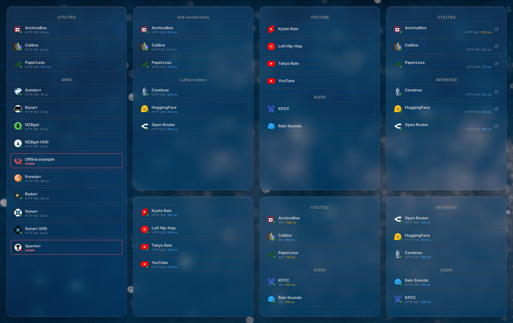

Seven copies of the same widget on one board, each with different options. The
board here carries a custom theme; every screenshot further down is stock
Homarr, dark mode, with no custom CSS.

Nothing in the definition names a specific app, so it is portable: install it,
tag some apps, and it works. Homarr has no dense multi-app widget; Bookmarks is
compact but carries no status.

See [WIDGET.md](WIDGET.md) for tagging, every option, and how the ping works.

## What it does

Every picture below is one copy of the widget. The only thing that changes
between them is the options on that copy, set from the tile's edit menu.

### Groups with live status

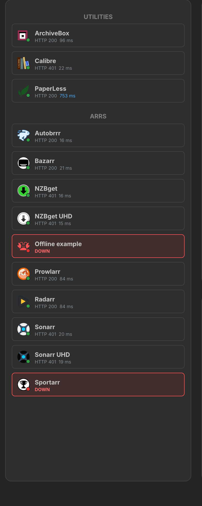

`categories` set to `utilities, arrs`. Each keyword becomes a group, in the
order you typed them, and every app whose description carries that keyword
lands in it. An app can carry several keywords and appear in several groups.

Each card shows a status dot, the HTTP status code and how long the ping took.
A 401 or 403 counts as up, because the service answered. An app that does not
answer at all reads `DOWN` and gets a red border and fill, so an outage is
visible without hunting for a dot, and **Highlight unreachable apps** turns
that off if you want the dot alone. Up to 24 apps per copy are pinged, in one
batched request.

### Your own headings

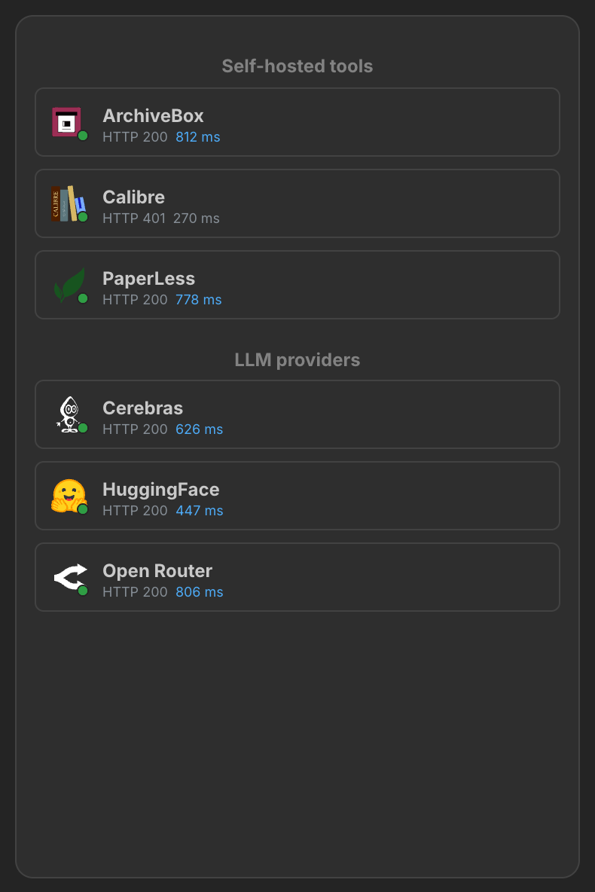

`categories` set to `utilities=Self-hosted tools, inference=LLM providers`,
with **Uppercase the headings** off. `keyword=Heading` prints a heading other
than the keyword, so the tag you type into an app can stay short while the
board reads the way you want.

### A plain link list

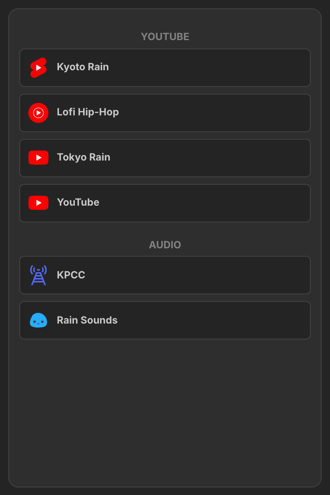

**Show status dots** off. No dots, no codes, no latency, and no requests at
all, which makes this a dense replacement for Bookmarks that is fed by the
apps you already have.

### Status on the right, and a new-tab mark

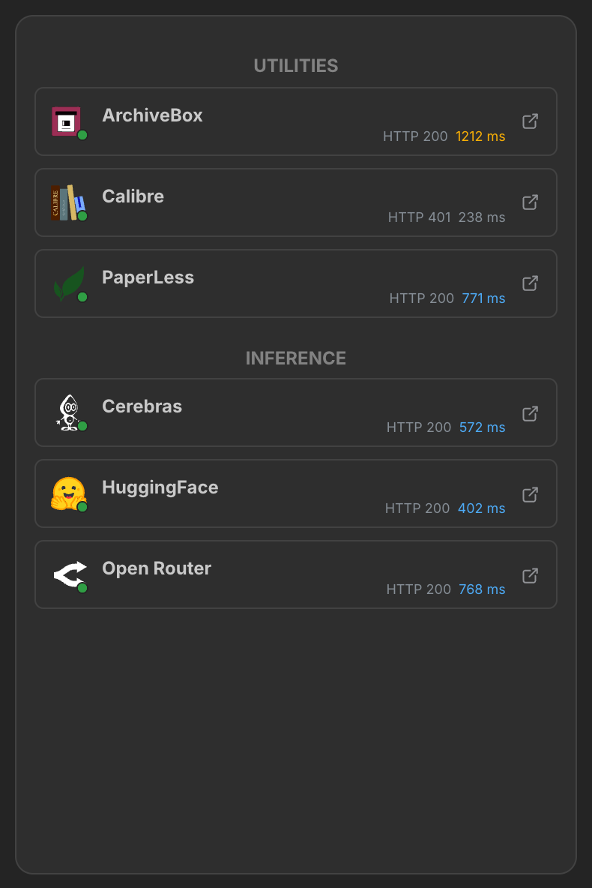

**Align status line right** and **Mark links that open a new tab** on. Cards
open the app in a new tab by default. **Open in a new tab** off opens it in the
same tab, and **Cards open the app** off removes the link, the pointer and the
hover underline, which makes the widget a read-only list of what you run.
**Underline name on hover** controls the underline on its own, and it is the
only hover effect the sandbox allows.

### Bigger cards

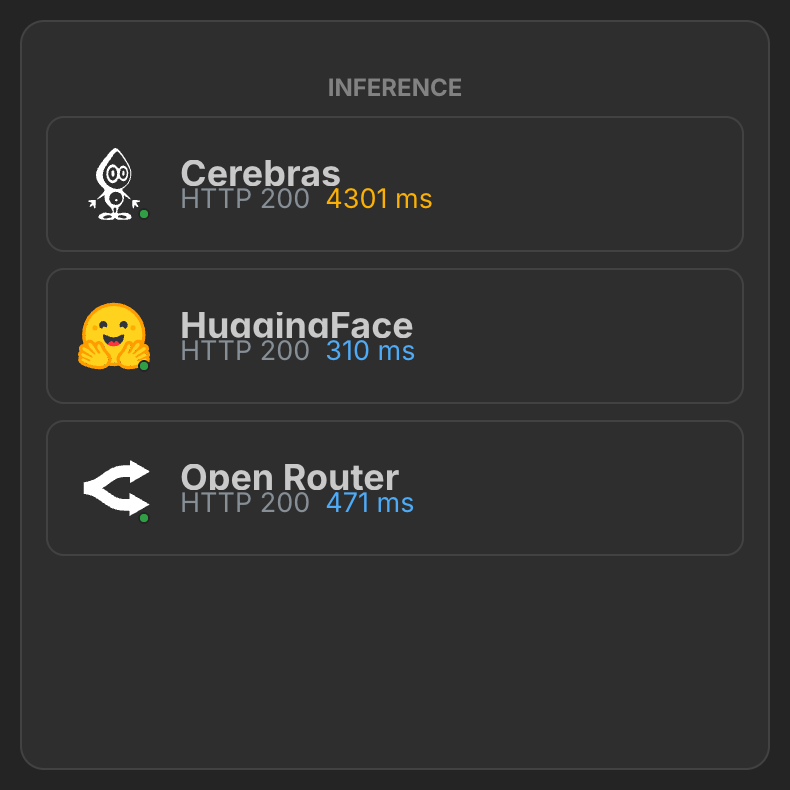

**Card size** set to 150%, from a choice of Normal, 125%, 150% and 200%. The
icon, dot, name, status line and padding scale together, while the headings and
the gaps stay as they are. It is set per copy, so a wide tile can carry big
cards next to a dense one, and it applies on every layout of the board. For a
size that applies on phones only, see [Card size](WIDGET.md#card-size) in the
widget reference.

### Dots without the numbers

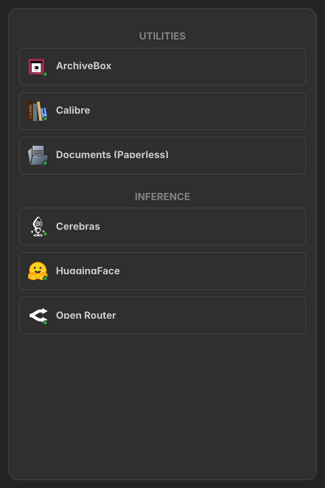

**Show status code** and **Show ping latency** off. The dot stays, and the card
loses its second line.

### One category, no heading

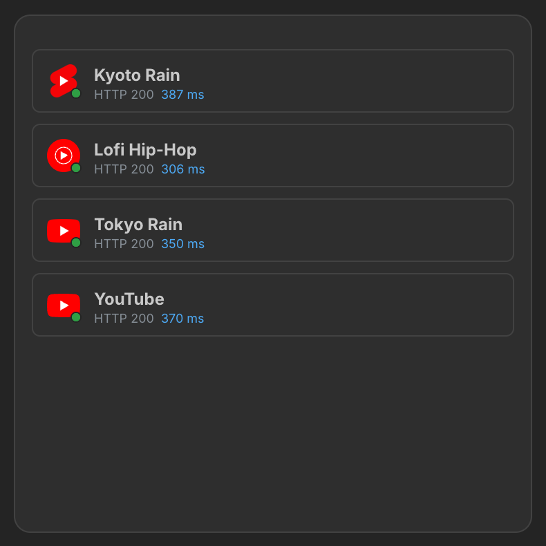

**Show category headings** off, for a tile whose own title already says what
is in it.

### Pinging only the first few

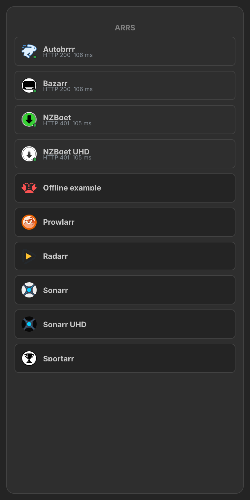

**Max apps with a dot** set to 4. Apps past the limit still show, with no dot
and no request spent on them. It counts from the top of the list, so numbering
your apps also decides which ones are pinged. Leave it blank for 24, the most
one copy can ping.

### Colour by value

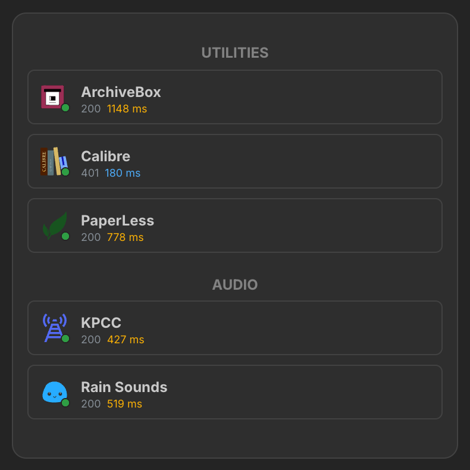

Latency changes colour at two thresholds you set per copy, here 20 ms and
400 ms, because an app pinged over the LAN and one pinged through a cloud
relay have different normal ranges. Status codes are coloured in three bands
the same way, and all six colours are options. The `HTTP ` prefix is cleared
here for the compact look; **Status code prefix** can hold any text.

### Order within a group

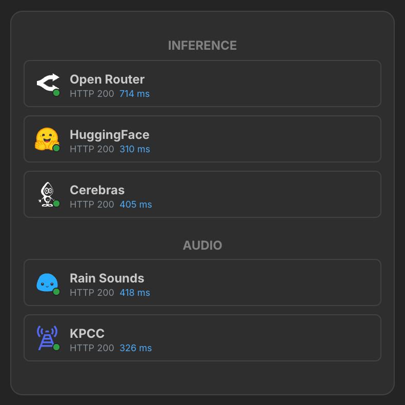

**Order within a category** set to Z to A. To place apps by hand, put a number
beside the keywords in an app's description, for example `media, 20`: numbered
apps come first, lowest first, and the rest follow by name.

### Finding your keywords

Leave `categories` blank and the widget lists every keyword it can find across
your apps, with a count beside each, as text you can select and copy straight
into the option. On an instance where no app has a description yet, it
explains how to tag one and links to the documentation instead of rendering
empty.

### Scrolling

**Scroll when the list is too tall** is on by default. Off clips the list at the
bottom of the tile instead of showing a scrollbar, which is tidier on a tile
you have already sized to fit.

### All of them at once

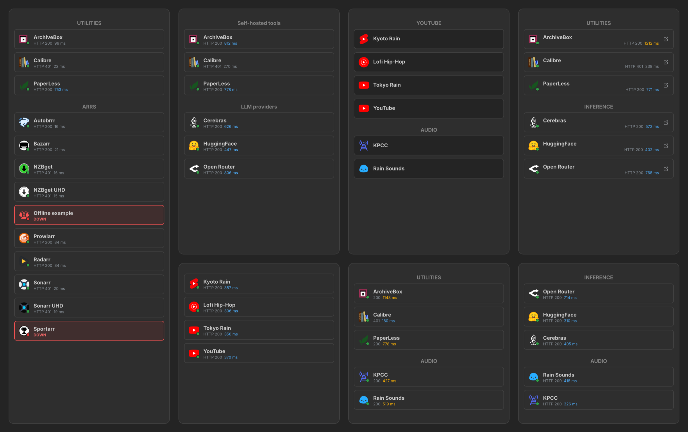

## Every option

Set per copy, from the tile's edit menu. [WIDGET.md](WIDGET.md#options) says
what each one does.

| Option | Key | Default | Works when |
| --- | --- | --- | --- |
| Categories to show | `categories` | blank | always |
| Order within a category | `appSort` | A to Z | always |
| Card size | `cardSize` | Normal | always |
| Show category headings | `showCategoryHeader` | on | always |
| Uppercase the headings | `headerUppercase` | on | Show category headings on |
| Show status dots | `showStatus` | on | always |
| Max apps with a dot | `statusLimit` | `24` | Show status dots on |
| Highlight unreachable apps | `highlightDown` | on | Show status dots on |
| Show status code | `showCodes` | on | Show status dots on |
| Status code prefix | `codePrefix` | `HTTP ` | Show status code on |
| Status code colour | `codeColor` | `gray.6` | Show status code on |
| Status code colour: questionable | `codeWarnColor` | `orange.6` | Show status code on |
| Status code colour: error | `codeErrColor` | `red.6` | Show status code on |
| Show ping latency | `showLatency` | on | Show status dots on |
| Latency colour | `latencyColor` | `gray.6` | Show ping latency on |
| Latency warning threshold (ms) | `latencyWarnMs` | `300` | Show ping latency on |
| Latency colour: warning | `latencyWarnColor` | `blue.4` | Show ping latency on |
| Latency bad threshold (ms) | `latencyBadMs` | `1000` | Show ping latency on |
| Latency colour: bad | `latencyBadColor` | `yellow.6` | Show ping latency on |
| Align status line right | `statusAlignRight` | off | Show status dots on |
| Underline name on hover | `hoverUnderline` | on | Cards open the app on |
| Cards open the app | `clickToOpen` | on | always |
| Open in a new tab | `openInNewTab` | on | Cards open the app on |
| Mark links that open a new tab | `showNewTabIcon` | off | Cards open the app and Open in a new tab on |
| Scroll when the list is too tall | `scrollWhenTall` | on | always |

Homarr cannot grey out an option that depends on another, so an option in a
state that does nothing still shows in the form.

## Installing

Homarr keeps widget definitions in its own database, so the files here are the
editable originals and pasting them in is what deploys them. Homarr's **Import**
takes one complete widget JSON, which this repo does not ship, because the
template, requests and options are kept as separate files.

Under **Manage → Custom Widgets**, create a new widget and set up its API source
first. The widget reads your app list and pings through Homarr's own API, so it
needs a source with these values:

| Field | Value |
| --- | --- |
| Source ID | `default` |
| Base URL | `http://127.0.0.1:7575`, where Homarr listens inside its container |
| Network access | loopback |
| Authentication | API key in a header named `ApiKey`, with a key you create in Homarr |

A loopback source always means "this instance", so the same definition works on
any Homarr. Then paste each file into the matching section:

| File | Section |
| --- | --- |
| `description.txt` | General, Description |
| `template.jsx` | JSX, Template |
| `requests.json` | Requests |
| `options.json` | Options |

**Paste the template before the requests.** The validator checks the saved
template against the request config, so changing requests first can fail
against a template that has not caught up.

To update a widget already on a board, paste `template.jsx` and `options.json`
again. New options arrive with their defaults on every placed copy.

## Editing

`template.jsx` is **generated**. Edit `build-template.py` and re-run it:

```bash
python3 build-template.py
```

Hand edits to the `.jsx` are overwritten. The builder exists because the
template has to satisfy structural rules that are easy to break by hand, and it
checks three of them, exiting non-zero on any: bracket balance, that `SubFetch`
is still on one unbroken line, and that every option's `description` is within
512 characters and `label` within 128.

That last check matters because the workbench only rejects an over-long
description **on save**, after you have pasted, and the error does not name the
offending option.

## Checking a template before you paste it

`build-template.py` checks structure. It cannot tell you whether an expression
survives the interpreter, because that depends on the Homarr build. This does:

```bash
bash tools/sandbox-check.sh v2.9.1
bash tools/sandbox-check.sh 3aa14e22
```

Cases live in `sandbox-cases.json`. A case either names its apps or asks for a
generated instance (`"generate": {"count": 250, "tagsEach": 3}`), and the
generated ones are the point: four hand-written apps sit far inside every
budget, and a real board does not. A case can also set `"pings": 8` to assert
that its status batch carries exactly that many distinct apps.

It fetches Homarr's `packages/custom-widgets` at that ref, bundles the real
interpreter and renders `template.jsx` through it once per case, with the
categories option blank, renamed, mixed and matching nothing. Any ref, branch or
commit that carries the package works.

Two refs rather than one, because the sandbox is not one fixed set of rules. The
equality failure below renders fine on current source and fails on the build it
was deployed to, and checking only the newer one would have said the template
was healthy.

Pick the release you run for the new side; `v2.9.1` is the newest one checked.
With no ref the script uses `release/v2`, a pre-release branch that no 2.x
release descends from, so name a ref. `3aa14e22` is 2026-07-22, the first ref with the full component catalog, and it
still has the string-comparison equality that `47f6c1cc` fixed on 2026-09-24.
Anything released between those two dates behaves like it. Do not reach further
back than that for the old side: `83e3b22f` predates the catalog and silently
drops props that every shipped build accepts, `Anchor.href` among them, so it
reports failures that are not real.

Needs node, npx and network. Everything lands in `.sandbox-check/`, gitignored.

## The sandbox

Templates run in a restricted runtime: a whitelist of Mantine components, no
user-defined functions, and resource ceilings. On the pre-release builds this
widget was written against, most violations **rendered nothing at all**, with no
error, no fallback and no console message, so the only way to find them was to
bisect the template. These are the ones found the hard way.

### Silent failures

The sandbox has tightened its reporting since then. Where a note below says
v2.9.1, that was rechecked through `sandbox-check.sh`, which uses the real
interpreter with stub components, so it shows what the interpreter accepts and
not how the final component draws. The rest are unchanged from the older builds
and have not been rechecked; keep to them, since a template may run on either.

- **A `SubFetch` element must be written on one line.** Split its attributes
  across lines and it rendered nothing, taking the surrounding markup with it.
  v2.9.1 accepts the split form, and `build-template.py` still emits that whole
  element, attributes and children included, as one unbroken line so the
  template keeps working on older builds. If you reformat a template for
  readability, this is the thing not to reflow.
- **`SubFetch` must sit inside a list, one instance per item.** Wrapping a whole
  list in a single `SubFetch` renders nothing.
- **Its children must not nest arrays more than two deep.** Three-deep renders
  nothing.
- **Unlisted props killed the element** on older builds. Confirmed rejected
  there: `lh`, and `ta` with a dynamic value, and v2.9.1 accepts both. Use
  `style={{lineHeight}}` and `style={{textAlign}}` to work on either.
- **Blocked props:** `on*`, `className`, `classNames`, `classes`, `component`,
  `children`, `ref` and a few more, listed in
  `packages/custom-widgets/src/jsx/policy.ts`. There is no way to attach a hover
  effect or a click handler. On v2.9.1 the element survives: the prop is dropped
  and the diagnostics report `BLOCKED_CAPABILITY`.
- **`Tooltip` was stripped**, silently, while its child still rendered. v2.9.1
  lists it in the component catalog and passes it through, so test it on your
  build before relying on it.

### Loose equality is not loose

`==` and `!=` are implemented as `String(left) === String(right)` in the build
this widget was first deployed against, so **`undefined != null` is true**. A
`value != null ? value : fallback` guard therefore takes the `value` branch when
the value is missing, and the next method call on it fails with a visible
`RUNTIME_RENDER_ERROR`: `Calling method 'trim' is not allowed`, naming whatever
method happened to be next. The message points at the method; the bug is the
comparison.

Newer builds special-case null on both sides and behave like JavaScript, which
is why this reproduces on one Homarr and not another.

- **Use `||` for a fallback, or `=== undefined` / `=== null` when an empty
  string has to survive.** `===` and `!==` are real strict equality in every
  build.
- **`.trim()` itself is allowed**, along with `split`, `join`, `toLowerCase`,
  `toUpperCase`, `includes`, `startsWith`, `endsWith`, `slice`, `substring`,
  `replace`, `replaceAll`, `indexOf`, `padStart`, `padEnd`, `charAt`, `repeat`,
  `match` and `search`. Every one of them raises that same
  `Calling method 'x' is not allowed` when the receiver is `undefined` or an
  array, so read the error as a wrong receiver before suspecting the method.
- **A blocked or misdirected call is found at call time, not at paste time.**
  The workbench saves the template without complaint. Place a copy with every
  option blank and a copy fully configured before calling a template good, or
  run `tools/sandbox-check.sh`, which renders the template against the real
  interpreter.

### Things that are true but not obvious

- **`SubFetch` results never appear in `data` or `status`.** They reach only the
  children function. An absent `status.<id>` is not evidence the request failed.
  The **request log** in the diagnostic pane is the reliable signal, and reading
  it earlier would have saved hours.
- **`trigger="auto"` fires on mount. `trigger="visible"` does not stagger
  anything.**
- **Concurrent requests are capped.** On v2.9.1 the limits are 4 per user and
  tile, and 8 per widget definition across every copy, from
  `packages/custom-widgets/src/server/request-limits.ts`. Older builds behaved
  as a cap of roughly 8.
- **A refused connection returns a *successful* slot whose `statusCode` is
  absent**, not an errored slot. Treat anything outside 100-599 as down.
- **Boards set `user-select: none`** so tiles can be dragged, which kills text
  selection. An inline `style={{userSelect:'text'}}` overrides it, and works in
  view mode only.

### An em is only as stable as what it inherits from

Sizing in em fixes the UI-scale problem but introduces a subtler one: the basis
is whatever the parent's font size happens to be, and the parent is not always
the same element. A card with an href is wrapped in an `Anchor`, which is a
`Text` underneath and carries its own font size; a card without one is not
wrapped at all. The same `size="0.5625em"` then rendered at two visibly
different sizes on the same board, a link card and a non-link card side by
side.

`fz` on the card's `Paper` pins the basis, so everything inside is relative to
one known value whatever the card turns out to be. Since the `cardSize` option
that value is also the card's size: `calc(var(--mantine-font-size-md) * n)`,
hoisted onto each app as `_fz`, and every dimension in the card is em (icon
1.5em, dot 0.5em, name 0.75em, padding 0.625em, radius 0.375em), so one font
size scales the lot and a stylesheet rule on the Paper can do the same for a
phone. Measured after the change: the ceilings in the tables below did not
move, at 100% or at 200%.

### An app with no href is not a link

Homarr lets an app be saved with a null or empty `href`, and `isSafeUrl`
accepts only `#...`, a single-slash path, or an http(s) URL with no credentials
in it. Wrapping such an
app in an `Anchor` produces, once per render:

```text
INVALID_PROP_VALUE: 'Anchor.href' contains an unsafe URL
```

It is a warning rather than a failure, so the board still renders and the only
sign is the warning count in the widget's diagnostics. The template treats an
app with no href as not clickable, which is the same path as view-only mode: no
anchor, no pointer, no glyph. The test is `a.href` itself rather than a
comparison, because an absent href is null and an empty one is `""`, and the
comparison form cost enough to push the glyph path past the operation limit.

### TablerIcon takes three props and drops the rest

`SafeTablerIcon`, in `packages/widgets/src/custom-api/jsx-icon-adapter.tsx`,
reads three props and draws its own `<svg>` from them, on v2.9.1:

```js
if (isValidIconProp(props.size)) size = props.size;
if (typeof props.color === "string") color = props.color;
if (isValidIconProp(props.stroke)) stroke = props.stroke;
```

So **`size`, `color` and `stroke` are the only props that reach the icon**.

`size` is handed to the SVG as a raw width and height, while everything Mantine
renders goes through `calc(px * var(--mantine-scale))`. On a board with the UI
scale above 1 that difference is visible: a fixed `size={18}` stays 18 real
pixels while the text beside it grows, so the icon looks smaller the further
the scale goes up. Give `size` an em value and it tracks the inherited, already
scaled font size. The same trap applies to any hardcoded pixel size in a
template, including `size="9px"` on a `Text`.
`opacity`, `ml`, `style` and every other global prop pass the analyser, render
without an error, and then do nothing, which is a slow thing to notice because
the icon still appears. Dim it with `color`, not with `opacity`. An unknown
`name` renders `null` rather than failing, so a typo is silent too.

### Options

- **A `select` stores a string, even when the choice looks numeric.** The
  option validator requires a string for every control outside `number`,
  `slider`, `duration`, `switch`, `multiSelect` and `json`, and it runs against
  the declared `default` as well as stored values, so a numeric choice is
  refused on save with `options.<name>.default Expected text`. The settings
  form coerces a numeric choice back to a number, which is what makes this look
  supported. Declare the numbers as text and convert them in the template.
- **Removing an option key orphans the stored value** on every already-placed
  copy, which surfaces as a validation error on the board. Changing a key's
  *type* is safe; removing or renaming it is not.

### Budget, and what actually spends it

The collection budget is 4000 items and the operation budget 25,000, and a real
board reaches both. What they cost:

| Operation | Collection cost |
| --- | --- |
| `map`, `filter`, `flatMap`, `find`, `some`, `reduce` | 1 per item |
| `join`, `includes`, `indexOf` on an array | the whole array's length |
| `sort` | 1 per comparison, so n log n |
| `split` and `match` on a string | 1 per part produced |
| **every other string method** | **free** |

That last row is the lever. This widget's picker went from failing at 100 apps
to clearing 350 by moving work into strings:

- **`.replaceAll(" ", "")` in place of `.split(" ").join("")`.** The split/join
  pair charges twice per word, so one prose description cost six items instead
  of none. This ran once per app, in both the picker and the grouping.
- **Counting by splitting a delimited string** rather than
  `keys.filter((x) => x === k).length` per category, which was unique x total
  and on its own took a 189-app board down.
- **Deduplicating through a string accumulator** in one `reduce`, rather than
  `filter` plus `indexOf`, which is n squared because `indexOf` charges the
  array's length every call.
- **Sorting only when the list is short.** Sorting the full key list is n log n
  at the moment the budget is already tight.

Measured ceilings for this widget on v2.9.1, by raising the app count through
the same interpreter `tools/sandbox-check.sh` uses until the render fails:

| Board | Apps before it fails |
| --- | --- |
| 1 keyword per app | 558 |
| 2 keywords per app | 355 |
| 3 keywords per app | 260 |
| every description a different sentence | 310 |
| **apps shown in one widget's categories** | **86** |

That last one is the operation budget rather than the collection budget, it is
about rendering cards rather than about the picker, and it has been there from
the start. Split a bigger category across two widgets.

It moves with the link options, measured rather than estimated:

| Card | Ceiling |
| --- | --- |
| before the link options existed | 94 |
| default: clickable, new tab, no glyph | 86 |
| **Open in a new tab** off | 86 |
| **Card size** 200% | 86 |
| **Show status dots** off | 90 |
| **Cards open the app** off | 92 |
| **Mark links that open a new tab** on | 85 |

Nine cards of headroom went on making the link optional, and only one of those
is the glyph. The cost is the choice itself: the card is emitted three times per
app, as the trigger content, the fallback and the resolved child, and JSX
attribute values are evaluated when the element is built rather than when it is
shown. Hoisting the option reads onto each app beside `_q`, and moving the
`Anchor` out to wrap the whole `SubFetch` once instead of each card variant,
both helped less than expected: 86 and 85 against 84 for reading the options
inline. That is why the hoisted form shipped, not because it was free.

It moves with the order inside a category too, and here the change went the
other way. Every row above was remeasured after the comparator was rewritten,
which is why they sit two higher than the numbers quoted in the paragraph
before this one; the gaps between rows are what that paragraph is about.

| Order | Ceiling |
| --- | --- |
| A to Z, nothing numbered | 86 |
| Z to A | 85 |
| every app carrying the same number | 84 |
| every app numbered differently, names and numbers shuffled | 80 |

The comparator used to compare the category heading before it compared the
name. Once `categories` is set the group index has already separated the
groups, so that tier could never differ, and it cost four guarded property
reads on every one of the n log n comparisons. The order number, the
lowercased name and the direction are instead computed once per app, in the
`map` that already attaches the heading, and the comparator only reads fields.
With names in shuffled order that took the ceiling from 74 cards to 107, which
is more than reading a number out of each description costs: the worst
numbered case measured lands at 74 again, where the widget started.

A comparator is the most expensive place in a template to do anything, because
it runs more often than any other callback. Read an option there and it is
read n log n times. Hang it on the item first.

The picker pays a little for the same feature, because it now drops numeric
keywords so that an order number is not offered as a category. That is one
`isFinite` per keyword: free for a board of short keywords, and 331 down to
310 where every description is a sentence.

### Resource limits

| Limit | Value |
| --- | --- |
| Operations | 25,000 |
| Collection operations | 4,000 |
| Rendered nodes | 10,000 |
| AST depth | 64 |
| Template length | 50,000 |
| String length | 200,000 |
| Option `description` | 512 |
| Option `label` | 128 |

Also: a regex must pass a conservative safety check, which on older builds ruled
out `+`, `*` and `{n,}` altogether while v2.9.1 accepts a plain `/a+/`; callbacks
only as direct arguments to safe collection methods; `.sort()` requires an
inline comparator.

**The 512 and 128 are per option**, not widget-wide, from
`packages/custom-widgets/src/core/options-schema.ts`. This row previously read
"Description / name 512 / 128", which was easy to read as the widget's own name
and description, and a `categories` description written at 517 characters got
through review on that basis.

The workbench rejects an over-long description **on save**, after you have
already pasted, and the error does not name the offending option. So
`build-template.py` checks `options.json` against both limits and
exits non-zero, naming the option and its length. Worth copying into any new
widget's builder: it turns a confusing save failure into a build failure you
can read.

**The two that matter pull against each other.** Binding a value with
`[x].map((y)=>…)` costs about four AST levels on everything beneath it, so
inlining the value instead saves depth, but then it recomputes per item and
costs collection operations. The way out is to put the binding somewhere the
deep path does not traverse, computing it inside a value expression and
unwrapping with `[0]`. `build-template.py` does this for both the
keyword list and the ping params.

Long `a+b+c+d` chains nest one level per `+`; `[a,b,c,d].join("")` is flat.
